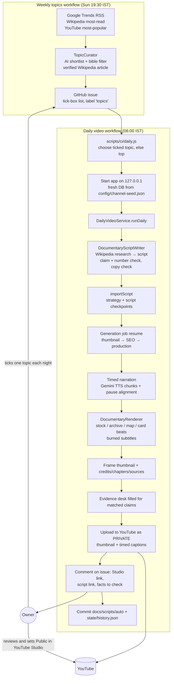
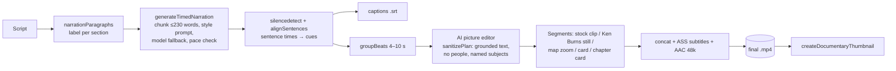

# Architecture

This is the Curious Files fork of YouTube Automation Agent (v2.11.0). The upstream agent pipeline is unchanged in shape (strategy → script → thumbnail → SEO → production → review → publish). This fork adds a daily documentary pipeline that runs on GitHub Actions or on the local server.

## Daily video (GitHub Actions)

Secrets (`.env`, `config/credentials.json`, `config/tokens.json`) come from GitHub Secrets `ENV_FILE`, `CREDENTIALS_JSON` and `TOKENS_JSON`. Each run writes them to files and deletes them when it finishes. Stock clips and images are cached between runs with `actions/cache`.

## Production pipeline (one video)

## Key modules

| Module | Role |
| --- | --- |
| `utils/topic-curator.js` | Trend signals → AI topic shortlist; bible filter, Wildcard tagging, verified article, honest trending flag. |
| `utils/documentary-script-writer.js` | Research pack from Wikipedia → script JSON → Markdown in the approved-script format; checks claims, numbers and copied wording, and retries with fixes. |
| `utils/daily-video-service.js` | Nightly pick, one build per day, catch-up after sleep or restart, `reconcile()` recovery, notifications. Never publishes. |
| `scripts/import-approved-script.js` | Markdown script → strategy and script checkpoints of a resumable job (shared by hand-written and automatic scripts). |
| `utils/narration-timing.js` | Sentence split, chunking, silence parsing, sentence alignment, subtitle cues, SRT/ASS. |
| `utils/ai-video-generator.js` | Gemini TTS (style, voice, model fallback, retries), timed narration, video style switch. |
| `utils/documentary-renderer.js` | Beats, visual direction, stock vetting (tags + AI look at the preview), Commons/NASA search, Natural Earth maps, cards, segment encoding, burned subtitles. |
| `utils/documentary-thumbnail.js` | Best real frame + grounded, no-hype text. |
| `utils/description-credits.js` | Chapters, sources, AI disclosure and credits in descriptions (≤ 5,000 chars, idempotent). |
| `utils/progress-tracker.js` | In-memory progress for topics, video and publish (`GET /api/progress`). |
| `utils/ai-retry.js` | Retries, backup Gemini text models, per-call deadline. |
| `scripts/ci/*` | GitHub Actions entry points: seed DB, topic issue, daily run, private upload. |
| `scripts/e2e-check.js` | `npm run e2e`: preflight + 30-second test video through the real pipeline; never uploads. |

## Data and state

- Local runs: SQLite at `data/` (or `YAA_DB_PATH`). Generated scripts are in `data/scripts-generated`, media in `data/videos` and `data/audio`, caches in `data/videos/stock-cache` and `data/media-cache`.
- Cloud runs: a fresh database per run. `state/history.json` (made topics and YouTube IDs) and `docs/scripts/auto` are committed back to the repo, and the topic issue holds the list and the owner's ticks.

Decisions are recorded in [docs/adr](docs/adr).
